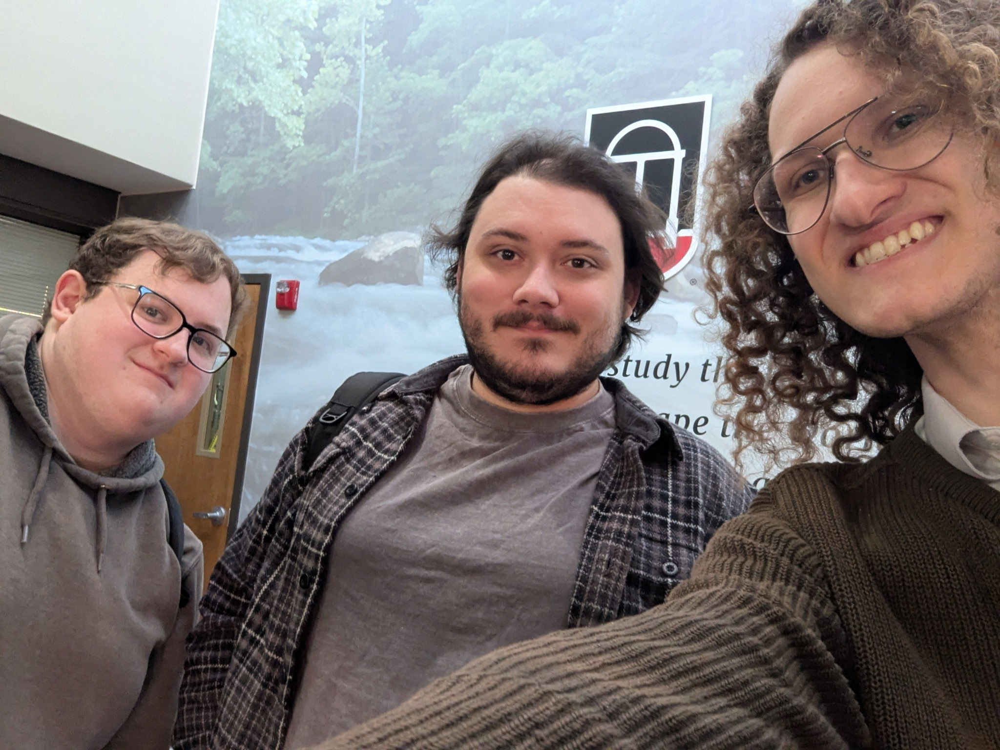

# Weekly Status Report

**Project Name:**  CSCI Class Forum
**Group Name:**  Group 7
**Project Manager:**  Noah Horne

---

## Group Selfie
Upload image to `/images/` and link it below:

---
## Progress Summary - **Week #1:**  Monday, October 12th -  Sunday, October 18th

** What we completed this week:**  
- This week we created the initial mockups for how we would like our project to look
-  

** Issues / blockers encountered:**  
-  Few issues were encountered this week
-  

** Goals for next week:**  
-  For next week we would like to complete the functional version of the UI
-  

---

## Progress Summary - **Week #2:**  Monday, October 19th -  Sunday, October 25th

** What we completed this week:**  
- 
-  We completed the functional UI part of the project

** Issues / blockers encountered:**  
-  
-  CSS is tedious, Maps are hard, Everything is difficult.

** Goals for next week:**  
-  
-  Get done quicker.

---

## Progress Summary - **Week #3:**  Monday, October 26th -  Sunday, November 1st

** What we completed this week:**  
- We completed finish up the CSS more.
-  

** Issues / blockers encountered:**  
-  CSS is very long to type out.
-  

** Goals for next week:**  
-  Get more done and do it quicker.
-  

---

## Progress Summary - **Week #4:**  Monday, November 2nd -  Sunday, November 8th

** What we completed this week:**  
- We completed the MongoDB connection
-  

** Issues / blockers encountered:**  
-  Had some confusion on where the items should go in MongoDB
-  

** Goals for next week:**  
-  Finish up the project and start working on the presentation
-  

---

## Progress Summary - **Final Week:**  Monday, November 9th -  Sunday, November 15th

** What we completed this week:**  
- We completed the Auth, API, and CRUD
-  

** Issues / blockers encountered:**  
-  API documentation was lengthy and wordy
-  MongoDB confusion

** Video preparation plans:**  
-  Download OBS in order to make the video
-  
** Presentation preparation plans:**  
-  Give a mock presentation before in order to be more experienced.
-  
---

