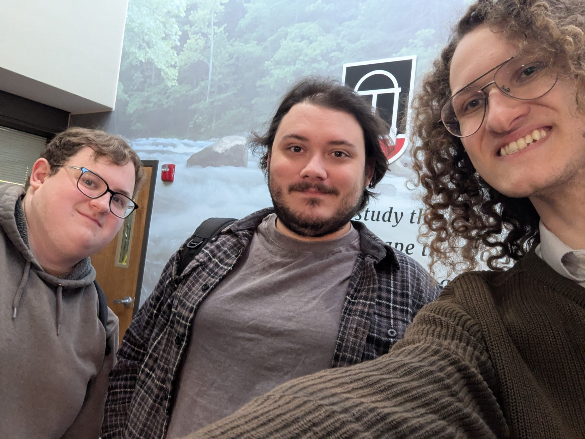

# Weekly Status Report

**Project Name:**  
**Group Name:**  
**Project Manager:**  

---

## Group Selfie
Upload image to `/images/` and link it below:

---
## Progress Summary - **Week #1:**  Monday, October 12th -  Sunday, October 18th

** What we completed this week:**  
- This week we created the initial mockups for how we would like our project to look
-  

** Issues / blockers encountered:**  
-  Few issues were encountered this week
-  

** Goals for next week:**  
-  For next week we would like to complete the functional version of the UI
-  

---

## Progress Summary - **Week #2:**  Monday, October 19th -  Sunday, October 25th

** What we completed this week:**  
- 
-  We completed the functional UI part of the project

** Issues / blockers encountered:**  
-  
-  CSS is tedious, Maps are hard, Everything is difficult.

** Goals for next week:**  
-  
-  Get done quicker.

---

## Progress Summary - **Week #3:**  Monday, October 26th -  Sunday, November 1st

** What we completed this week:**  
- 
-  

** Issues / blockers encountered:**  
-  
-  

** Goals for next week:**  
-  
-  

---

## Progress Summary - **Week #4:**  Monday, November 2nd -  Sunday, November 8th

** What we completed this week:**  
- 
-  

** Issues / blockers encountered:**  
-  
-  

** Goals for next week:**  
-  
-  

---

## Progress Summary - **Final Week:**  Monday, November 9th -  Sunday, November 15th

** What we completed this week:**  
- 
-  

** Issues / blockers encountered:**  
-  
-  

** Video preparation plans:**  
-  
-  
** Presentation preparation plans:**  
-  
-  
---

